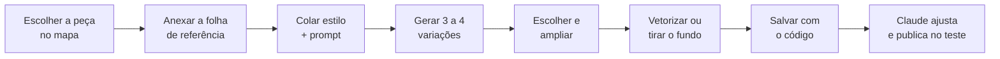

# Guia de imagens · Site Inner v2

Sep 26, 2026 · @Eduardo Di Renzo

São 74 peças em quatro camadas: cenas principais, ilustrações de apoio, famílias de ícones e padrões. Todas seguem um único bloco de estilo e partem da mesma folha de referência, para que ChatGPT, Gemini, Figma Weave, Firefly e Canva entreguem imagens da mesma família.

## Como usar

Cada peça tem um código (H-01, P-03, G-02). O código liga o mapa, que diz onde a imagem entra, ao prompt, que diz o que gerar.



Na última etapa eu ajusto as cores para a paleta exata, otimizo o arquivo (SVG, WebP ou AVIF), encaixo no site e publico em /v2-teste/ para revisão.

### Qual ferramenta para qual peça

| Ferramenta | Onde brilha | Use para |
| --- | --- | --- |
| ChatGPT (geração de imagem) | Segue bem instruções de composição e entrega fundo transparente | Hero, ilustrações dos topos, ícones |
| Gemini (Nano Banana) | Mantém o estilo das imagens anexadas e aceita ajustes em conversa | Variações de uma peça aprovada, família de ícones |
| Figma Weave (conectado aqui) | Nano Banana 2 e Pro com referências, e Recraft Vectorizer para SVG | Só funciona daqui com o plano pago do Weave; hoje está indisponível |
| Adobe Firefly (conectado aqui) | Estilo por referência, vetorizar, remover fundo, expandir a imagem | Fundos, capas de vídeo, limpeza das peças geradas |
| Canva (conectado aqui) | Montagem com texto e marca | Eu gero daqui com a folha de referência anexada (testado na H-01 com bom resultado); também monta G-03 e G-05 |

Regra prática: a peça nasce onde gerou o melhor resultado, e todas passam pelo mesmo acabamento antes de entrar no site.

## Direção de arte

Ilustração editorial adulta e sóbria, no nível de uma revista de negócios ou do relatório anual de uma consultoria. O público é executivo, liderança e RH, então a imagem precisa transmitir confiança, discrição e método. Nada infantil, nada de desenho animado, nada de banco de imagens.

### Prompt de abertura (colar uma vez, no início da conversa no ChatGPT)

```text
Você vai ser o ilustrador do novo site da Inner Placement, uma consultoria brasileira de desenvolvimento e transição de carreira para executivos: recolocação, outplacement e desenvolvimento de lideranças. O público são executivos, líderes e áreas de RH de empresas.

Direção de arte para todas as imagens desta conversa:
- Ilustração editorial contemporânea, adulta e sóbria, no nível de revistas de negócios e relatórios de consultorias. Nada infantil, nada de desenho animado, nada de banco de imagens.
- Pessoas com proporções adultas realistas, roupa profissional discreta e rosto sem detalhes. Diversidade de gênero e de idade, com predomínio de 40 a 60 anos.
- Paleta restrita: tinta #231F20, areia #D3CEC4, areia clara #EFEBE4 e branco quente, com acentos de coral #FF6558 e âmbar #F2B45C usados com parcimônia (a luz, um detalhe, um objeto).
- Arcos e formas arredondadas como assinatura visual, luz natural suave, textura sutil de papel ou grão, bastante respiro.
- Sem texto, letras, números ou logotipos na imagem.
- Evitar clichês: escadas para o céu, alvos, troféus, lâmpadas, foguetes, quebra-cabeças, xadrez, aperto de mão, gráficos subindo, pessoas pulando de alegria.

Antes de gerar qualquer imagem, me responda só com 3 rotas de estilo diferentes dentro dessa direção, com nome e duas linhas cada. Eu escolho uma e depois geramos seção por seção, mantendo a mesma rota em todas as imagens.
```

### Depois de escolher a rota

- Gere o hero primeiro. Quando uma imagem ficar boa, escreva: "Esta é a referência de estilo. Todas as próximas imagens devem parecer da mesma série."
- Peça ajustes na mesma conversa ("mantenha tudo, só troque...") em vez de começar do zero.
- Para cada nova seção, cole só o prompt dela. O contexto de abertura continua valendo.
- Ao abrir uma conversa nova, cole de novo o prompt de abertura e anexe a imagem de referência aprovada.
- O ChatGPT gera em 1536 × 1024 (horizontal 3:2), 1024 × 1024 (quadrado) ou 1024 × 1536 (vertical). Peça o horizontal para as cenas; eu faço o recorte para 16:9 na hora de encaixar no site.

## Folha de referência

Use esta folha apenas para os ícones pequenos, que seguem os pictogramas oficiais da marca. Para as cenas, não anexe: ela puxa o gerador para um traço infantil. As composições oficiais aparecem sem os rótulos de texto, para o gerador não aprender a escrever na imagem.

&#91;image: Folha de referência da marca Inner para geração de imagens\]

O arquivo original, em 2400 × 1580 px, vai junto na conversa para você salvar e anexar.

## Especificações técnicas

Gere sempre maior do que o espaço no site e com fundo transparente. Na entrada do site eu converto e reduzo o arquivo.

| Tipo de peça | Peças | Proporção | Gerar em | Entrega no site | Peso máximo |
| --- | --- | --- | --- | --- | --- |
| Ilustração de painel | H-01, P-01 a P-09 | 16:9 | 2048 × 1152 px, fundo transparente | SVG se chapada; senão WebP e AVIF | 60 KB (SVG) ou 120 KB (WebP) |
| Ícone | H-02 a H-05, H-09, G-04 | 1:1 | 1024 × 1024 px, fundo transparente | SVG | 15 KB |
| Ilustração de canto | H-10, G-01 | 1:1 | 1024 × 1024 px, fundo transparente | SVG | 40 KB |
| Fundo ou textura | H-07, H-08 | 3:2 | 2400 × 1600 px | WebP e AVIF | 150 KB |
| Capa de vídeo | H-06, G-02 | 16:9 | 1920 × 1080 px | WebP e AVIF | 120 KB |
| Imagem de compartilhamento | G-03, G-05 | 1,91:1 | 1200 × 630 px | JPG | 300 KB |

Regras que valem para todas:

- Nenhum texto dentro da imagem. A única exceção é G-03 e G-05, montadas no Canva com o nome da marca.
- Sem fotografia real; nas ilustrações, pessoas com rosto sem detalhes.
- Nome do arquivo: `inner-<código>-<assunto>-v<número>`, por exemplo `inner-H01-hero-v2.png`.
- Pasta: `site_v3/apoio/`, a mesma dos SVGs oficiais.
- Guarde também o prompt e a ferramenta usados, num arquivo `.txt` com o mesmo nome. Isso permite refazer a peça no mesmo estilo depois.

## Mapa da home

A home tem 10 espaços. H-01, H-02 e H-03 decidem a primeira tela e vêm primeiro. H-08 é o diagrama oficial do método, que fica como está; ali só entra uma textura opcional por trás.

&#91;image: Mapa da home no desktop com os espaços de imagem numerados\]

| Código | Seção | Onde entra | O que o texto diz | O que a imagem mostra | Prioridade |
| --- | --- | --- | --- | --- | --- |
| H-01 | Hero | Painel à direita do título; no celular, abaixo do subtítulo | Crescer ou fazer uma transição pede clareza, estratégia e alguém junto até acontecer | Um ponto de partida que se abre em dois caminhos, com uma segunda figura acompanhando nos dois, até a rosácea | 1 |
| H-02 | Caminhos | Disco claro no bloco coral "Para você" | Quem quer chegar ao próximo nível, ou encerrou um ciclo e precisa decidir o próximo passo | Uma figura dando um passo para uma plataforma mais alta | 1 |
| H-03 | Caminhos | Disco claro no bloco tinta "Para sua empresa" | A empresa cuida das pessoas quando alguém cresce e quando alguém sai | Um arco acolhendo figuras: uma sobe, outra sai acompanhada | 1 |
| H-04 | Por que a Inner | Ícone do selo "Para quem está em transição" | Leitura precisa, estratégia, network ativado, do primeiro encontro à recolocação | Rota pontilhada com três marcos, o último preenchido | 2 |
| H-05 | Por que a Inner | Ícone do selo "Para quem quer crescer" | Impacto desejado, estratégia de desenvolvimento, espaço confidencial | Um núcleo coral com anéis que se expandem | 2 |
| H-06 | Prova | Capa do vídeo da Gisele Hinz | O processo inteiro, inclusive a parte difícil | Fundo quente e discreto, sem figuras, com espaço livre para o botão de play | 2 |
| H-07 | Por que a Inner | Fundo do bloco branco (opcional) | Duas leituras: quem você é e onde quer chegar | Duas linhas suaves que se encontram, em tom muito leve | 3 |
| H-08 | Método | Atrás do diagrama oficial (opcional) | Quatro dimensões que se encontram no objetivo | Textura bem sutil; o diagrama não é gerado | 3 |
| H-09 | Perguntas | Ícone ao lado do título | O que costumam perguntar antes de conversar | Dois balões de conversa arredondados e uma rosácea pequena | 3 |
| H-10 | Manifesto | Canto superior direito do cartão | Lapidamos o que cada pessoa já construiu, para que fique visível | Uma forma lisa que revela a rosácea por dentro | 2 |

No celular, H-01 ocupa a largura toda e H-02 e H-03 ficam menores, ao lado do selo. Por isso os ícones precisam funcionar em 56 px.

&#91;image: Mapa da primeira tela da home no celular\]

## Mapa das páginas internas e peças globais

Cada página interna tem um espaço no topo, à direita do título. Hoje ele guarda uma peça do kit, que será trocada pela ilustração gerada. No celular esse espaço some, para o título subir; a ilustração é vista no computador e no tablet.

&#91;image: Topos das nove páginas internas com o espaço da ilustração marcado\]

| Código | Página | O que o texto diz | O que a imagem mostra | Prioridade |
| --- | --- | --- | --- | --- |
| P-01 | Transição e Recolocação | Dois programas, mesmo método: Platinum com acompanhamento próximo, Focus com autonomia e apoio nos momentos decisivos | Duas rotas até a mesma rosácea: numa, a companhia vai lado a lado; na outra, aparece nos marcos | 1 |
| P-02 | Desenvolvimento de Carreira | Crescer é uma decisão: assumir mais, ganhar relevância, preparar o próximo movimento | Uma figura que cresce no lugar, sobre plataformas que se ampliam | 1 |
| P-03 | Desenvolvimento de Executivos | Executivos que a empresa não quer perder chegam a um novo patamar; contratado pela empresa, construído com o executivo | Um arco (a empresa) que sustenta uma figura subindo, com outra ao lado | 1 |
| P-04 | Outplacement | A forma de conduzir a saída faz parte da cultura e da reputação da empresa | Uma figura sai por um arco acompanhada, e o caminho continua subindo | 1 |
| P-05 | Depoimentos | O processo inteiro, contado por quem viveu | Balões de conversa de tamanhos diferentes, cada um com uma figura pequena | 2 |
| P-06 | Perguntas frequentes | Dúvidas organizadas por momento de carreira | Balões em sequência que viram uma trilha até a rosácea | 3 |
| P-07 | Manifesto | Caminhar junto até acontecer; na relação, com método, o difícil ganha clareza | Duas figuras caminhando lado a lado até uma rosácea grande | 2 |
| P-08 | Contato | Conte o que você deseja; nenhum contato sem a sua autorização | Uma forma de envelope arredondada, aberta, com a rosácea saindo e um cadeado discreto | 2 |
| P-09 | Agradecimento | Recebemos a sua mensagem e vamos responder | A rosácea em flor, com uma trilha pontilhada chegando ao centro | 3 |

### Peças globais

| Código | Onde entra | O que comunica | Prioridade |
| --- | --- | --- | --- |
| G-01 | Fechamento de todas as páginas, sobre o fundo tinta | Todo movimento de carreira começa com uma conversa | 1 |
| G-02 | Capas dos vídeos de Rafael Massardo, Thiago Celso e Vinícius Conde | Mesmo fundo da H-06, com variação de cor e posição para cada pessoa | 2 |
| G-03 | Imagem que aparece ao compartilhar a home no WhatsApp, LinkedIn e e-mail | H-01 reduzida, com o logo e o título da página ao lado | 1 |
| G-04 | Ícone do bloco "O que a empresa acompanha" (Executivos e Outplacement) | A empresa vê a evolução, não o conteúdo das conversas | 2 |
| G-05 | Modelo de compartilhamento das páginas internas | A ilustração de cada página com o título dela | 3 |

O logo nunca é gerado pela IA: nas peças G-03 e G-05 ele entra depois, pelo arquivo oficial `logo.svg`. A frase "Até acontecer." pode aparecer como texto, mas nunca ao lado do logo.

## Plano completo de ilustrações

Além das 24 peças do mapa, entram mais 50, organizadas em quatro camadas. Cada seção do site passa a ter uma cena que a conta e ícones para cada ideia que se repete. Os componentes do site serão adaptados para receber cada peça conforme ela for aprovada.

| Camada | Papel | Formato |
| --- | --- | --- |
| Cena principal | Conta a seção inteira numa imagem | 16:9, SVG ou WebP |
| Ilustração de apoio | Acompanha um cartão, programa ou parágrafo | 4:3, SVG |
| Ícone | Marca uma ideia recorrente (etapa, dimensão, número) | 1:1, SVG, legível em 24 px |
| Padrão | Textura ou divisor entre seções | Faixa repetível, SVG |

### Home: 18 peças novas

| Código | Seção | Camada | O que é |
| --- | --- | --- | --- |
| H-11 | Hero | Ícone | Etapa "posicionamento": figura em destaque sobre um círculo claro |
| H-12 | Hero | Ícone | Etapa "network ativado": figuras ligadas por uma trilha pontilhada |
| H-13 | Hero | Ícone | Etapa "até acontecer": trilha que termina na rosácea |
| H-14 | Hero | Padrão | Faixa de pétalas soltas para a base do hero |
| H-15 | Caminhos | Ícone | "Quero crescer onde estou": figura subindo no mesmo lugar |
| H-16 | Caminhos | Ícone | "Estou saindo, ou já saí": figura atravessando um arco |
| H-17 | Caminhos | Ícone | "Preparar quem precisa crescer": arco sustentando uma figura |
| H-18 | Caminhos | Ícone | "Cuidar de quem sai": figura saindo acompanhada |
| H-19 | Por que a Inner | Apoio | Transição: leitura do profissional e o mercado como caminhos que se cruzam |
| H-20 | Por que a Inner | Apoio | Crescimento: impacto na organização, num espaço reservado e confidencial |
| H-21 | Prova | Ícone | "+15 anos": uma trilha longa com muitos marcos |
| H-22 | Prova | Ícone | "+1500 profissionais": um grupo denso de cabeças de figuras |
| H-23 | Prova | Ícone | "86% em 4,5 meses": poucos marcos até a rosácea |
| H-24 | Prova | Ícone | Aspas desenhadas com duas pétalas coral |
| H-25 | Método | Ícone | Contexto individual: uma figura no centro de um círculo |
| H-26 | Método | Ícone | Ambiente e cultura: uma figura dentro de um arco maior |
| H-27 | Método | Ícone | Potencial e recursos: uma figura com pétalas brotando |
| H-28 | Método | Ícone | Cenário futuro: um horizonte arredondado com a rosácea nascendo |

### Páginas internas: 29 peças novas

| Código | Página | Camada | O que é |
| --- | --- | --- | --- |
| P-11 | Transição | Apoio | Platinum: figura com acompanhante constante, a consultora ao lado o tempo todo |
| P-12 | Transição | Apoio | Focus: trilha estruturada com encontros nos momentos decisivos |
| P-13 a P-18 | Transição e Outplacement | Ícones | As seis etapas: leitura da trajetória, direcionamento, currículo e LinkedIn, network, job hunting, entrevistas |
| P-19 | Desenvolvimento de Carreira | Apoio | Next Level para a pessoa: crescer no ritmo do dia a dia |
| P-20 a P-23 | Carreira e Executivos | Ícones | O que se desenvolve: competência, comportamento, forma de se posicionar, o que aparece no caminho |
| P-24 | Desenvolvimento de Executivos | Apoio | Next Level na empresa: objetivo alinhado entre executivo, empresa e Inner |
| P-25 | Outplacement | Apoio | Platinum para lideranças: saída conduzida com acompanhamento próximo |
| P-26 | Outplacement | Apoio | Focus em grupo: cada pessoa com o seu próprio caminho, mesmo saindo juntas |
| P-27 a P-29 | Depoimentos | Ícones | As três seções: Transição, Outplacement, Crescimento |
| P-30 a P-34 | Perguntas frequentes | Ícones | As cinco seções: Para começar, Para quem quer crescer, Para quem está em transição, Para empresas, Investimento e condições |
| P-35 a P-38 | Manifesto | Apoio | Uma pequena ilustração para cada um dos quatro parágrafos |
| P-39 | Contato | Ícone | Sigilo: cadeado arredondado com uma pétala |

### Globais: 3 peças novas

| Código | Camada | O que é |
| --- | --- | --- |
| G-06 | Padrão | Divisor de pétalas entre seções claras |
| G-07 | Padrão | Trilha pontilhada ondulada que liga uma seção à seguinte |
| G-08 | Padrão | Textura de rosáceas para os blocos tinta |

Os prompts dessas 50 peças entram no guia rodada por rodada, seção por seção, escritos a partir do texto aprovado de cada uma e das peças já escolhidas.

## Prompts da home (ChatGPT)

Os prompts são curtos porque o tom e a paleta já foram fixados no prompt de abertura. Cada um diz onde a imagem entra, o formato e o que a cena precisa contar a partir do texto daquela seção.

### H-01 · Hero

```text
Imagem para o topo do site, formato horizontal. O terço esquerdo deve ficar mais calmo, porque o título fica ao lado.
Tema: uma decisão importante de carreira (crescer onde está ou fazer uma transição) e a presença de alguém experiente que acompanha até o resultado.
Cena: uma executiva ou executivo num momento de reflexão e, perto dela, um conselheiro presente de forma discreta. A composição sugere dois caminhos possíveis sem ser literal. Tom sereno e confiante.
```

### H-19 · Por que a Inner, coluna "Para quem está em transição"

```text
Imagem de apoio, formato horizontal.
Tema: leitura cuidadosa do profissional e estratégia de mercado no mesmo processo.
Cena: um consultor e um profissional numa sala de reunião clara, analisando juntos um grande quadro com anotações e cartões (sem texto legível), como quem desenha um plano.
```

### H-20 · Por que a Inner, coluna "Para quem quer crescer"

```text
Imagem de apoio, formato horizontal.
Tema: desenvolvimento com impacto na organização, num espaço profissional e confidencial, fora da hierarquia da empresa.
Cena: uma executiva em conversa reservada com um mentor sênior numa sala tranquila, porta fechada, cadernos abertos, clima de confiança.
```

### H-06 · Capa do vídeo em destaque

```text
Fundo para capa de vídeo, formato horizontal.
Cena: ambiente de escritório elegante e desfocado, com luz quente de fim de tarde entrando pela janela. Nenhuma pessoa nítida. O centro deve ficar limpo para um botão de play.
```

### H-07 e H-08 · Texturas de fundo (opcionais)

```text
Textura de fundo, formato horizontal, muito sutil e de baixo contraste.
Arcos arquitetônicos em luz suave sobre areia clara, sem pessoas e sem objetos. Deve funcionar atrás de texto sem atrapalhar a leitura.
```

### H-10 · Manifesto

```text
Imagem quadrada.
Tema: não reinventamos ninguém; lapidamos o que cada pessoa já construiu, para que fique visível.
Cena: natureza-morta editorial sobre superfície clara, com uma pedra bruta ao lado de outra já polida, luz lateral suave, sombras delicadas. Sofisticado e silencioso.
```

### G-01 · Fechamento "Todo movimento de carreira começa com uma conversa"

```text
Imagem quadrada, para ficar sobre um bloco de fundo escuro (tinta #231F20).
Cena: duas poltronas frente a frente numa sala silenciosa, uma mesa pequena entre elas com duas xícaras, luz quente de abajur. Ninguém sentado ainda: o momento antes da conversa.
```

### Ícones da home (H-02 a H-05, H-09, H-11 a H-18, H-21 a H-28)

Os ícones continuam na linha dos pictogramas oficiais, com a folha de referência anexada. Use um modelo só e troque o tema:

```text
Crie um ícone para site no estilo de ícones de linha profissionais: traço de 2 px em tinta #231F20, cantos arredondados, um único detalhe em coral #FF6558, fundo transparente, formato quadrado, sem texto. Deve funcionar em 24 px e ser coerente com a folha de referência anexada.
Tema: [tema do ícone]
```

| Código | Tema |
| --- | --- |
| H-02 | Uma pessoa dando um passo para um patamar mais alto |
| H-03 | Um arco acolhendo pessoas: uma sobe, outra sai acompanhada |
| H-04 | Uma rota com três marcos, o último destacado |
| H-05 | Um núcleo com anéis que se expandem |
| H-09 | Dois balões de conversa sobrepostos |
| H-11, H-12, H-13 | Posicionamento; network ativado; chegada ao objetivo |
| H-15 a H-18 | Crescer no lugar; atravessar uma porta em arco; ser sustentado para subir; sair acompanhado |
| H-21, H-22, H-23 | Trajetória longa; grupo grande de pessoas; poucos marcos até o objetivo |
| H-24 | Aspas desenhadas com duas pétalas |
| H-25 a H-28 | Contexto individual; ambiente e cultura; potencial e recursos; cenário futuro |

## Prompts das páginas internas (ChatGPT)

Cada página tem uma cena de topo e, quando há programas, uma imagem de apoio por programa. Todas no formato horizontal.

### Transição e Recolocação

```text
P-01 · Topo da página.
Tema: uma transição de carreira bem conduzida combina decisão fundamentada e execução precisa.
Cena: um executivo em transição caminhando por um corredor amplo e iluminado de um prédio corporativo, ao lado de uma consultora, ambos serenos. Sensação de passagem para uma nova etapa.
```

```text
P-11 · Programa Platinum.
Tema: acompanhamento próximo e exclusivo em todas as etapas, com uma consultora dedicada.
Cena: consultora e executivo lado a lado numa sala reservada, revisando juntos um plano de carreira num notebook (tela sem texto legível). Ambiente premium.
```

```text
P-12 · Programa Focus.
Tema: a pessoa conduz a própria transição com autonomia, com apoio nos momentos decisivos.
Cena: profissional trabalhando com foco na mesa de casa, bem organizada, com uma videochamada discreta com a consultora na tela do computador (sem texto legível).
```

### Desenvolvimento de Carreira

```text
P-02 · Topo da página.
Tema: crescer na carreira é uma decisão; assumir mais e ganhar relevância no que já faz.
Cena: uma executiva num mezanino do escritório, olhando o espaço de trabalho abaixo com postura de liderança tranquila. Crescer onde está.
```

```text
P-19 · Programa Next Level (para a pessoa).
Tema: encontros individuais que se ajustam ao dia a dia, num espaço confidencial fora da hierarquia da empresa.
Cena: encontro de mentoria entre uma executiva e um consultor sênior num café silencioso, caderno aberto, luz natural.
```

### Desenvolvimento de Executivos

```text
P-03 · Topo da página.
Tema: executivos que a empresa não quer perder e que precisam chegar a um novo patamar.
Cena: diretora de RH e um executivo conversando numa sala de diretoria com vista para a cidade. A empresa investindo no desenvolvimento de um líder.
```

```text
P-24 · Programa Next Level (contratado pela empresa).
Tema: objetivo alinhado entre executivo, empresa e Inner.
Cena: três pessoas numa mesa de reunião (o executivo, uma representante da empresa e um consultor) alinhando objetivos diante de um quadro com cartões sem texto.
```

### Outplacement

```text
P-04 · Topo da página.
Tema: a forma como a empresa conduz a saída de cada profissional faz parte da sua cultura e da sua reputação.
Cena: um profissional deixando o escritório pela porta principal ao fim do dia, acompanhado de uma consultora, ambos serenos. Dignidade e cuidado, nunca tristeza.
```

```text
P-25 · Programa Platinum (lideranças).
Tema: transições de maior complexidade, com leitura de trajetória e ativação de network.
Cena: executiva sênior em sessão estratégica com um consultor, diante de um quadro com cartões organizados em grupos (sem texto legível).
```

```text
P-26 · Programa Focus (desligamentos em grupo).
Tema: cada pessoa com o seu direcionamento, mesmo quando o desligamento é em grupo.
Cena: pequeno grupo de profissionais numa oficina prática conduzida por uma consultora, cada pessoa com o seu próprio material, clima respeitoso e concentrado.
```

### Demais páginas

```text
P-05 · Depoimentos.
Cena: um profissional sendo entrevistado para um vídeo num estúdio simples e elegante, luz suave, câmera desfocada em primeiro plano. O processo contado por quem viveu.
```

```text
P-06 · Perguntas frequentes.
Cena: duas pessoas numa primeira conversa, sentadas a uma mesa de café num escritório claro, postura aberta e atenta. Tom acolhedor e profissional.
```

```text
P-07 · Manifesto.
Cena: duas pessoas caminhando lado a lado por um passeio arborizado entre prédios corporativos, conversando. Caminhar junto até acontecer.
```

```text
P-08 · Contato.
Cena: mesa de trabalho organizada com um caderno aberto e uma xícara, luz da manhã. Sensação de começo e de privacidade. Sem pessoas.
```

```text
P-09 · Agradecimento.
Cena: luz quente da manhã entrando por uma janela num escritório silencioso. Sensação de algo que começou bem. Sem pessoas.
```

### Ícones das páginas internas

Use o mesmo modelo de ícone da home. Temas: as seis etapas da transição (P-13 a P-18: leitura da trajetória, direcionamento, currículo e LinkedIn, network, job hunting, entrevistas); o que se desenvolve (P-20 a P-23: competência, comportamento, forma de se posicionar, o que aparece no caminho); as seções de Depoimentos (P-27 a P-29) e do FAQ (P-30 a P-34); sigilo (P-39); e o que a empresa acompanha (G-04).

## Ordem de produção e aprovação

Comece pela H-01. Ela define o estilo da série inteira, então nenhuma outra peça deve ser gerada antes de ela ser aprovada.

| Rodada | Peças | Por que nessa ordem |
| --- | --- | --- |
| 1 | H-01 (3 a 4 variações no ChatGPT e 3 a 4 no Gemini) | Define o traço, a figura e a cor da série |
| 2 | H-02, H-03, G-01 | Completa a primeira tela e o fechamento, que aparece em todas as páginas |
| 3 | P-01, P-02, P-03, P-04 | As quatro páginas de serviço, que recebem o tráfego da home |
| 4 | H-04, H-05, H-06, H-10, G-02, G-04 | Ícones, capas de vídeo e o manifesto |
| 5 | P-05 a P-09, G-03, G-05, e os opcionais H-07, H-08, H-09 | Acabamento e compartilhamento |

A cada rodada, me mande as escolhidas. Eu encaixo no site de teste e você vê a peça no lugar certo antes de seguir para a próxima.

### Checklist de cada peça antes de entrar no site

- [ ] Usa só as seis cores da paleta
- [ ] Nenhum texto, letra ou número dentro da imagem
- [ ] Tom adulto e profissional; pessoas com proporções realistas e rosto sem detalhes
- [ ] Nenhum canto reto, sombra, brilho ou efeito 3D
- [ ] Parece da mesma série do hero aprovado
- [ ] Continua legível no tamanho real (ícones em 56 px e 20 px)
- [ ] Fundo transparente, quando a especificação pede
- [ ] Arquivo nomeado com o código e salvo em `site_v3/apoio/`
- [ ] Prompt e ferramenta anotados num `.txt` com o mesmo nome
